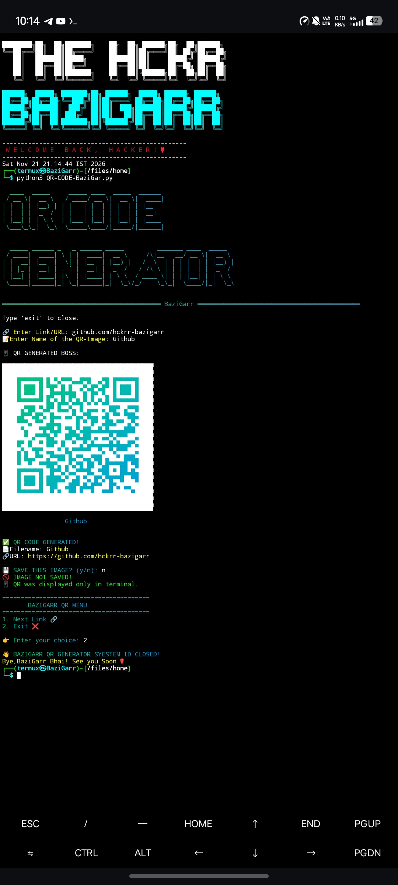

🔥 BaziGarr QR Generator

  <b>A Stylish Gradient QR Code Generator for Python</b>

  
  
  
  

---

🚀 About

BaziGarr QR Generator is a Python-based QR code generation tool designed for Android, Termux, and Linux environments.

Generate stylish QR codes with a beautiful Green → Cyan → Blue gradient design, preview them directly in your terminal, and save them as PNG images with matching gradient-colored filenames.

Simple. Stylish. Powerful.

✨ Features

- 🎨 Beautiful Green-Cyan-Blue gradient QR design.
- 📱 QR code preview directly in the terminal.
- 🌈 Gradient-colored filename in terminal and saved images.
- 🎯 Centered filename below the QR code.
- 🖼️ PNG image generation.
- 💾 Optional image saving with Y/N confirmation.
- 🔗 Automatic HTTPS prefix for URLs without a protocol.
- 🔄 Generate multiple QR codes without restarting.
- 📂 Automatic output directory creation.
- 🛡️ High QR error correction (Level H).
- 🏷️ Custom QR image filenames.
- ⚡ Interactive terminal interface.
- 🎭 FIGlet ASCII terminal banner.

---

⚡ QUICK INSTALLATION

Get BaziGarr QR Generator running in just a few steps!

1️⃣ Clone Repository

git clone https://github.com/csrb4zzigar-07/QR-CODE-GENERETOR.git

2️⃣ Open Project Folder

cd QR-CODE-GENERETOR

3️⃣ Install Python Dependencies

pip install -r requirements.txt

4️⃣ Install FIGlet

For Termux:

pkg update && pkg install figlet

For Kali Linux / Debian:

sudo apt update && sudo apt install figlet

5️⃣ Launch QR Generator

python3 "qr-code genretor"

<b>📦 All Installation Commands (Copy Together)</b>
Termux:

git clone https://github.com/csrb4zzigar-07/QR-CODE-GENERETOR.git
cd QR-CODE-GENERETOR
pkg update
pkg install python figlet
pip install -r requirements.txt
python3 "qr-code genretor"

Kali Linux / Debian:

git clone https://github.com/csrb4zzigar-07/QR-CODE-GENERETOR.git
cd QR-CODE-GENERETOR
sudo apt update
sudo apt install python3 python3-pip figlet
pip install -r requirements.txt
python3 "qr-code genretor"

---

📸 Preview

  

  <b>BAZIGARR QR GENERATOR</b>
   
  <i>Terminal QR generation with gradient styling.</i>

📋 Requirements

- Python 3.x
- pip
- FIGlet

Python dependencies are listed in "requirements.txt".

▶️ Usage

Step 1: Enter a URL

🔗 Enter Link/URL: https://github.com

Step 2: Enter an image name

📝 Enter Name of the QR-Image: GitHub

Step 3: Save your QR image

💾 SAVE THIS IMAGE? (y/n):

- Enter "y" to save the generated QR image.
- Enter "n" to skip saving.

Step 4: Generate another QR code

1. Next Link 🔗
2. Exit ❌

Choose "1" to generate another QR code or "2" to exit.

📂 Output Location

Default image save location:

/storage/emulated/0/Pictures/QR_CODE

Example:

Pictures/
└── QR_CODE/
    ├── GitHub.png
    ├── YouTube.png
    └── MyWebsite.png

Note: The default save path is configured for Android shared storage. On other Linux systems, you may need to change "SAVE_DIR" in the Python script.

⚙️ Customization

Customize the QR gradient and appearance:

GREEN = (0, 200, 115)
CYAN = (0, 185, 180)
BLUE = (0, 155, 225)

MODULE_SIZE = 12
BORDER = 4

🛠️ Built With

Technology| Purpose
Python| Core programming language
qrcode| QR code generation
Pillow| Image processing and gradient rendering
FIGlet| ASCII terminal banner

📁 Project Structure

QR-CODE-GENERETOR/
│
├── README.md
├── requirements.txt
├── terminal-preview.jpg
└── qr-code genretor

👨‍💻 Author

BaziGarr

Created with ❤️ and Python.

⭐ Support

If you like this project:

- ⭐ Star this repository.
- 🍴 Fork the project.
- 💡 Share suggestions and improvements.
- 🐛 Report bugs through GitHub Issues.

Contributions are welcome!

---

  <b>🔥 BAZIGARR QR GENERATOR 🔥</b>
   
  <i>Generate. Customize. Scan.</i>

